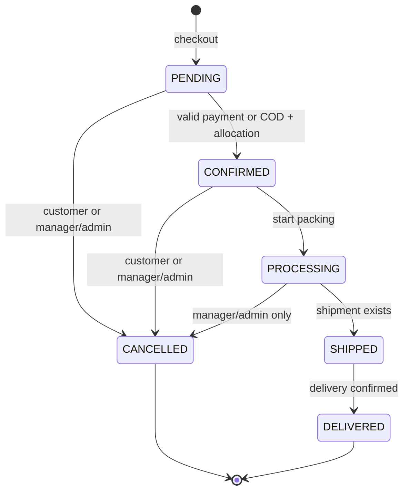

# Business workflows

## Purchase and inventory

```mermaid
sequenceDiagram
  participant C as Customer storefront
  participant API as Spring API
  participant DB as MySQL
  participant OMS as Internal OMS
  C->>API: POST /orders (IDs, quantities, address, simulation, key)
  API->>DB: Begin transaction; lock customer; check idempotency
  API->>DB: Lock products in ID order; lock inventory current reads
  API->>API: Validate active products/stock; calculate BigDecimal totals
  API->>DB: Save address snapshot, order and item price snapshots
  API->>API: Simulate card outcome or COD pending
  alt Approved card or COD
    API->>DB: Deduct stock; append allocation movements
  else Declined card
    API->>DB: Record FAILED payment; no stock allocation
  end
  API->>DB: Append payment event and order history; commit
  API-->>C: Order number, status, totals and payment result
  OMS->>API: GET /admin/orders
  API-->>OMS: Same persisted order
```

Duplicate requests with the same customer/key and payload return one order, one payment and one allocation. Conflicting key reuse is rejected. Locks are held until the transaction commits, preventing two customers from buying the same final unit. A failed checkout rolls back the entire order, even if an earlier item had enough stock.

Shipping is free at $100 subtotal; otherwise $9.95. No additional tax is calculated in the demonstration. The server never accepts authoritative prices or totals from a client.

## Fulfillment



1. Staff reviews the pending order and confirms it.
2. Staff moves it to processing.
3. Staff creates a shipment with carrier and estimated delivery. The API generates an `NVX` tracking number.
4. Staff dispatches the shipment or marks the order shipped. Both records update in the same transaction.
5. The customer sees tracking in their account.
6. Staff completes delivery; a COD payment changes from pending to paid with a simulated collection event.

No direct jump from pending to shipped. Declined payments cannot be confirmed. Tracking numbers and carrier delivery are demonstrations; no external carrier request is made.

## Payment failure and retry

A card decline creates a pending order with failed payment and zero stock reservation. The customer chooses “Retry simulated payment” on its order page. A success locks/checks stock again, allocates it and appends a paid payment event. A success is impossible if stock has sold out or the product was deactivated. An already paid order cannot be retried and charged twice.

## Cancellation

The API locks the order, checks ownership/role and permitted state, and restores stock only when `stockAllocated` is true. Each item gets a positive inventory movement. The flag becomes false, the order becomes cancelled, a paid payment becomes refunded, and history is appended. Repeating cancellation returns the existing cancelled record without restoring stock again. A label created before dispatch is voided by removing its unused shipment; its creation/cancellation history stays available.

No cancellation after dispatch/delivery. Customers cannot cancel once processing starts. Staff cannot cancel; manager/admin access is required for internal cancellation.

## Warehouse stock

Manager/admin searches inventory, enters a signed quantity change and a reason. The service locks the product and inventory, rejects negative resulting stock, saves the balance, and appends an actor-attributed movement. Storefront reads immediately show the new available stock. Low stock is `quantity <= lowStockThreshold` for active products.

## Authentication and role changes

Registration always creates a customer. Login creates a database session and a 15-minute JWT, plus a seven-day refresh token. Refresh rotates and revokes the old session; logout revokes it immediately. Every protected request rechecks the session and current user role/activity, so account deactivation or role changes take effect without waiting for JWT expiry. The UI hides unavailable navigation, and the API independently enforces the same access boundary.
