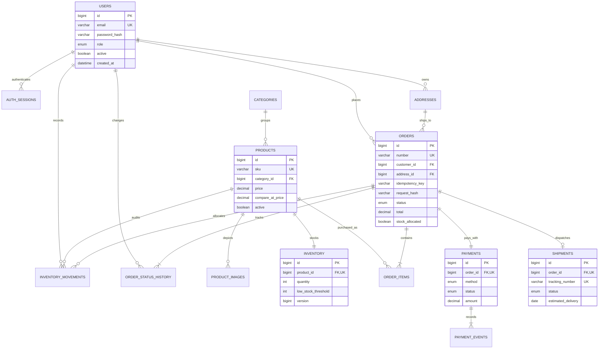

# Database design

MySQL 8.4, InnoDB, UTF-8 database, Flyway `V1__commerce_schema.sql`. Hibernate validates the schema; it does not create or alter production tables. Monetary amounts are `DECIMAL(12,2)` and Java `BigDecimal`. Timestamps use UTC; the browser formats presentation dates.

## Modeling decisions

Customer identity is a user with `CUSTOMER` role; a duplicate customers table would add no independent fields in this scope. A role enum is used instead of a role-join table because each account has exactly one of four fixed roles. The backend enforces the permissions associated with that role. Customers cannot be promoted into staff accounts through the team editor, preserving identity boundaries.

Each checkout stores an immutable shipping address snapshot. Saved addresses are surfaced from order history; changing profile details never changes a previous order. Order items snapshot product name, SKU and unit price. Product references remain valid after deactivation. There is no hard product delete.

Inventory is separate from the catalog. Every stock-in, stock-out, allocation, restoration and seed reconciliation adds a movement with actor, reason, delta, resulting balance and optional order link. `quantity >= 0` is checked both in service logic and the database. The version column adds defense against lost updates.

Each order has exactly one payment, multiple append-only payment events, and at most one shipment. A pre-dispatch shipment label is removed on cancellation; its creation and cancellation remain in order history. Order status history records actor, status, note and timestamp for every fulfillment action.

`(customer_id, idempotency_key)` is unique. A request hash rejects key reuse with a different payload. Email, SKU, category slug, order number, tracking number and refresh hash have unique constraints. Orders have date and status indexes; products have a category/active index; movements have a product/date index; foreign keys are indexed by MySQL.

Newsletter emails are unique in `newsletter_subscriptions`. The cart is the one permitted client-side temporary store and is not persisted as business data in MySQL. Authentication tokens are per-tab session storage; only opaque refresh token hashes are stored server-side.

## Test isolation and persistence

The container initialization creates `novara_test` separately from `novara`. Tests apply the same Flyway migration and use real MySQL transactions and locks. The `novara_mysql-data` Docker volume survives stop/start and container recreation. Never use `down -v` when retaining data.
