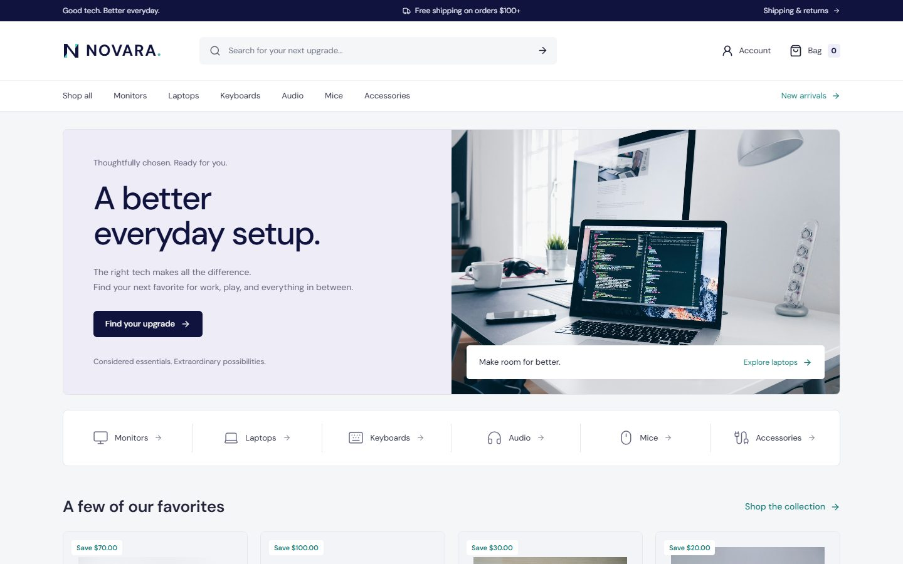
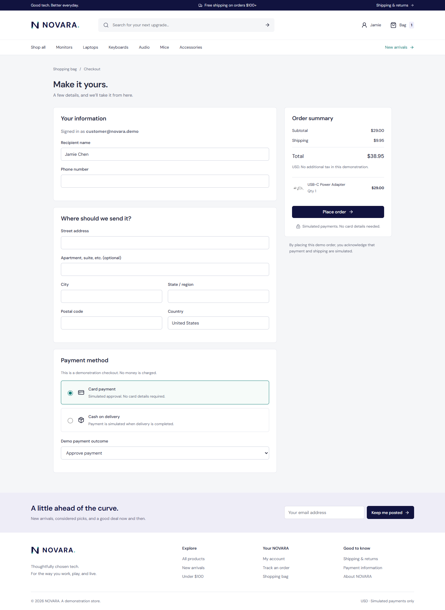
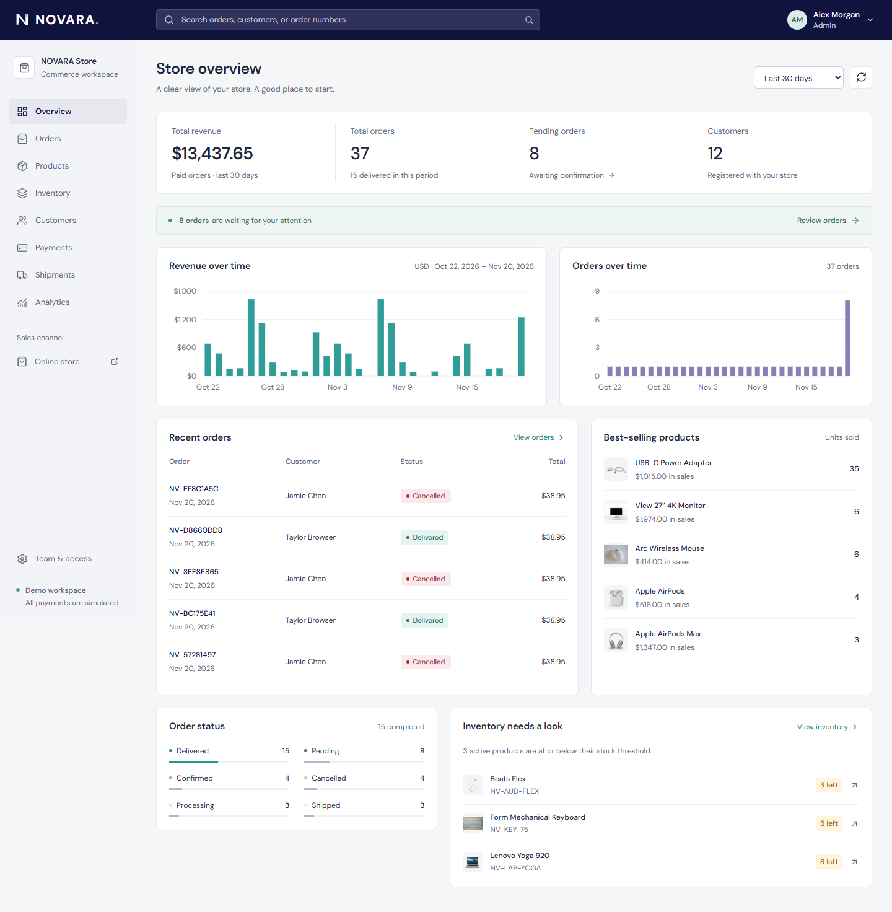
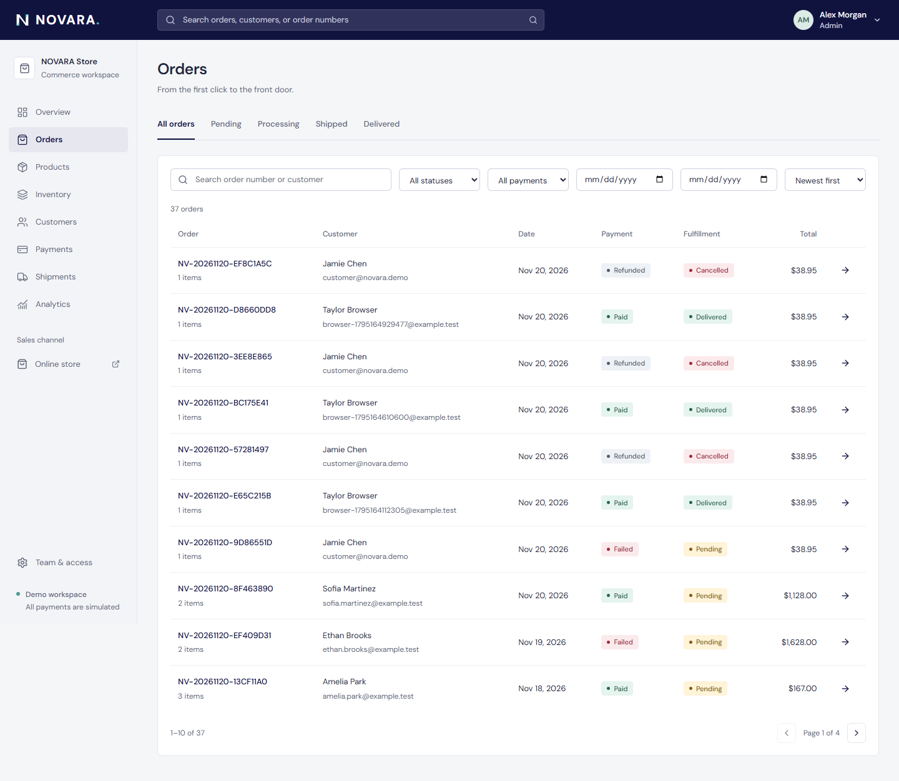
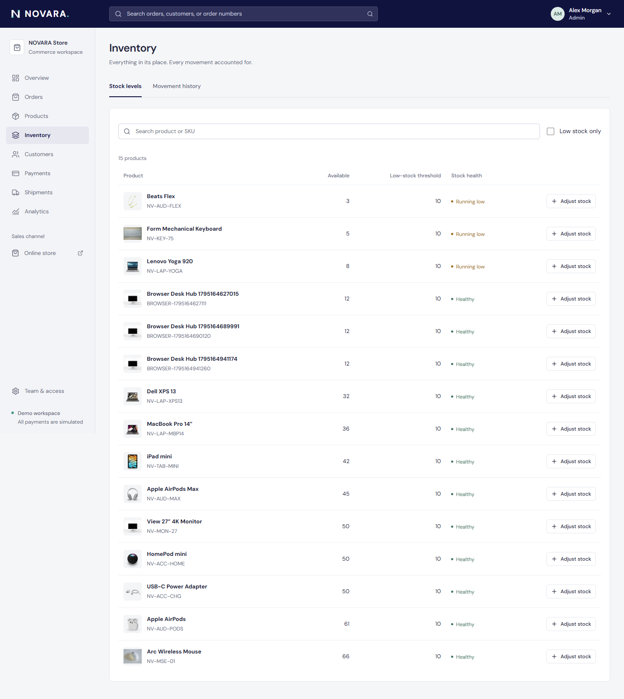
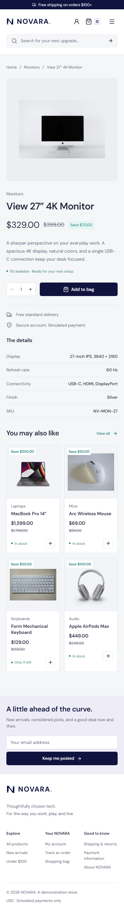
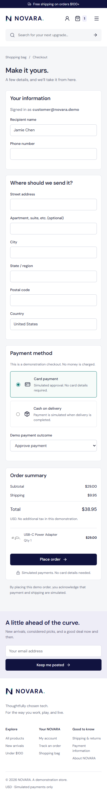
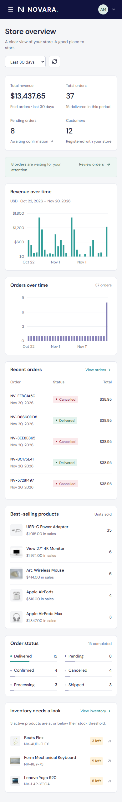

# Application screenshots

These screenshots were captured in Chrome from NOVARA's running storefront and OMS on November 20, 2026. Both applications use the real Spring Boot API and MySQL database. All people, orders and account details shown are demo data; browser-test records are retained in the audit history. Metrics reflect the database at capture time.

Desktop captures use a 1440px viewport; mobile captures use a 390px viewport. Full-page images can be opened at their original resolution by clicking them.

## Storefront

Search, category navigation and the featured collection share the OMS's navy, gray, teal and lavender visual system.

## Checkout

Customer information, shipping address, server-priced order summary and simulated payment selection.

## OMS dashboard

Revenue and orders over time, recent orders, best-selling products and low-stock alerts come from the database.

## Order management

Searchable orders with status, payment, date and sorting controls, plus links to individual orders.

## Inventory

Stock quantities, low-stock thresholds and adjustment actions. Test products remain in the internal inventory audit trail even after storefront deactivation.

## Mobile layouts

Product details, checkout and the OMS reflow for a phone-sized viewport. These are browser viewport captures, not physical-device certification.

| Product details | Checkout | OMS dashboard |
| --- | --- | --- |
|  |  |  |

[View the full mobile storefront contact sheet](screenshots/storefront-mobile-page.jpg).

## Related documentation

- [System architecture](SYSTEM_ARCHITECTURE.md)
- [Database ER diagram](DATABASE_DESIGN.md)
- [Verification results](TESTING.md)
- [Visual review](VISUAL_REVIEW.md)
- [Image sources](ASSETS.md)
