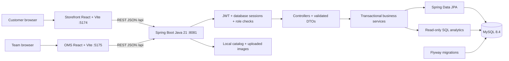

# System architecture

NOVARA is a modular monolith with two separately built and served clients. Neither client is a substitute for the database. The applications communicate through HTTP/JSON; storefront orders are immediately visible to the OMS because both read the same API.

## Modules

- `api`: HTTP routing, validated immutable request DTOs, explicit response views and error envelopes. Controllers delegate to services and do not query repositories directly.
- `domain`: entities and Spring Data repositories. Small related model types are grouped in `Model`; repositories are grouped in `Repositories`. The repositories have explicit entity names for JPQL and pessimistic write queries for transactional resources.
- `security`: BCrypt at strength 12; JWT signature/issuer/expiry verification; every request checks the database session, current role, account activity and revocation. Refresh tokens are opaque, stored only as SHA-256 hashes and rotated on use.
- `service`: catalog, people, images, checkout, allocation, cancellation, payment simulation, shipment state and aggregate analytics. DTO conversion occurs inside service transactions; Open Session in View is disabled.
- `frontend/shared`: one visual system and implementation of authentication, network errors, status indicators, forms, pagination, order views and product cards.

## Runtime modes

Development runs Java and both Vite processes on Windows with a Docker MySQL service. Production-style local execution uses Java 21 JRE plus two Nginx containers. Docker health checks sequence database → API → frontends. Nginx routes `/api` and `/media` to the backend, and SPA routes to `index.html`.

The Docker Compose project name is `novara`. Other projects’ containers are not modified. Ports bind to loopback. `mysql-data` and `uploads` persist independently of containers.

## State and failures

Database transactions encompass checkout records, payment events, inventory movements and order history. Product rows are locked in ascending ID order, followed by inventory current-read locks. Customer-level locks serialize idempotency keys. Order-level locks serialize fulfillment/cancellation/payment retry. SQL constraints enforce nonnegative inventory and positive prices.

The API returns 400 for malformed/invalid input, 401 for missing/expired/revoked authentication, 403 for role denial, 404 for unknown or non-owned orders, and 409 for conflicting state or stock. Unexpected errors are logged server-side and return a generic message without stack traces. Clients retain a visible error and expose retry where useful.

## Design

Reference-led frame with locally served DM Sans, Lucide outline icons, moderate 6–8px corners and shared navy/teal/lavender tokens. Storefront has catalog-oriented navigation; the OMS has a neutral sidebar and navy work header. Both use the same forms, statuses and order activity components. Mobile collapses the sidebar and keeps wide data tables inside their own scroll regions.
